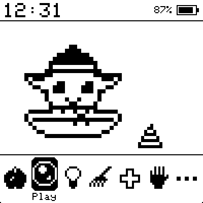
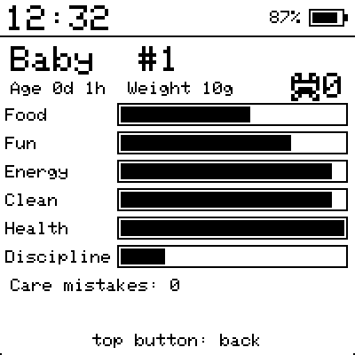
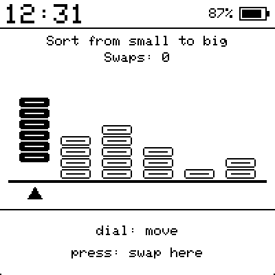
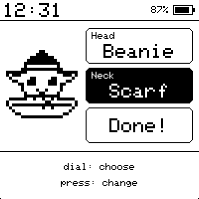

# CoreInk Tamagotchi

[](https://github.com/cmaranes/coreink-tamagotchi/actions/workflows/ci.yml)

A classic virtual pet for the **M5Stack CoreInk (K048)**, a 1.54" 200×200 e-ink ESP32 board, written in C++ with PlatformIO and M5Unified. The pet is a little green Grogu-style foundling. The UI is in **English and Spanish**, and you can switch on the device. The same code also builds as a **PC simulator**, so you can play and tune it without the hardware.

> Unofficial fan project, see the [disclaimer](#license-and-disclaimer).

<p>
  
  
  
  
</p>

<sub>Screenshots from the PC simulator, at 2× the 200×200 panel resolution.</sub>

## The game

| Stage | Lasts | Notes |
|---|---|---|
| Egg | 5 min | hatches by itself |
| Baby | 1 h | hungry often, poops often |
| Child | 1 day | |
| Teen | 2 days | |
| Adult | 10–25 days | one of four, depending on how you raised it (below) |

Which adult you get is decided at the end of Teen, in this order:

| Adult | How | Lives |
|---|---|---|
| Grumpy | more than 3 care mistakes | 10 days |
| Jedi | won *Force* 8+ times (since Child) and Discipline ≥ 60 | 25 days |
| Glutton | 25+ sweets (since Child) or overweight | 14 days |
| Mandalorian | everyone else | 20 days |

- **Stats:** Food, Fun, Energy, Clean, Health and Discipline. Look at them under *More → Stats*.
- **Menu:** Feed · Play · Light · Clean · Cure · Scold · More (Shop / Stats / Album / Language).
- It **sleeps from 21:00 to 08:00**. Turn the lights off when it goes to sleep, or it counts as a care mistake.
- **Waking it at night:** with the lights off, turn them on (*Light*) and it wakes up, a bit grumpy (−10 Fun). It can eat and play as usual. Turn the lights off to put it back to bed; if you don't, it falls asleep again by itself after an hour (with the lights still on, so turn them off).
- **Naps:** tired during the day? Turn the lights off (*Light*) while Energy is below 80 and it naps. A nap fills Energy completely in **5 minutes** (40 Energy left to go takes 2). It wakes by itself when Energy is full, or when you turn the light back on. A nap still running at 21:00 just becomes the night's sleep.
- Poop lowers Clean. Dirt, starvation or being overweight can make it **sick**. Sickness drains Health until you give medicine.
- Health 0 means it dies. Press the dial to hatch a new egg.
- A **care mistake** happens when hunger or fun sits at 0, or sickness goes untreated, for 30 minutes.
- An inverted **"!"** in the status bar means it needs you. The device also beeps once when that starts.

### Minigames
*Play* opens five games plus *Dress Up*. All are turn-based, so they suit e-ink. Winning gives more Fun than losing and earns **frogs**, the currency.
- **Left/Right.** 5 rounds: guess which way Grogu will look (dial up = left, down = right). 3 or more correct wins.
- **High/Low.** A number from 1 to 9 is shown: will the next one be higher (dial up) or lower (dial down)? It's never the same number twice. Keep guessing until you miss; 4 in a row wins, and 8 in a row ends the game. One frog per guess in a row past 3.
- **Force.** Memorise a sequence of ▲ ▼ ●, then repeat it with dial up / down / press. It starts at 3 moves and grows to 8. Repeating 4 or more counts as a win and as Force training for the Jedi.
- **Tidy Up.** KonMari tidying: six piles of folded clothes are shuffled on a shelf. Sort them from smallest to biggest. Move the cursor with the dial, press to pick a pile up, and press on another pile to swap them (top button puts it back). It always counts as a win: 3 stars (and frogs) for the fewest possible swaps, 2 stars for up to 2 extra, 1 otherwise. 3 stars says *A spark of joy!*
- **Joy?** First it shows the 3 things that spark joy for Grogu (from: ball, frog, macaron, sock, shirt, book). Then 8 things come up one by one: keep it (dial up) or thank it and let it go (dial down). 6 or more right calls win, one frog per right call past 5.

### Dress Up
*Play → Dress Up* dresses Grogu up. Turn the dial to pick *Head* (Beanie, Crown, Bow, Shades), *Neck* (Scarf, Bow Tie, Necklace) or *Done!*. Press to change the item, with a live preview, or to put the outfit on. The outfit stays on the home screen, and on the sleeping frame too. A new outfit gives +15 Fun, at most once an hour.

### Shop
*More → Shop* sells, for frogs: **Macaron** (3, big Fun boost, sweet), **Eggs** (2, a big meal), **Frog** (1, a little food and fun), **Bacta** (4, cures and restores Health, used from *Cure*) and the **Ball** from the Razor Crest (6, permanent, +Fun on every win). Foods you own appear in *Feed*.

### Tantrums and discipline
Sometimes it calls you ("!") without needing anything. That's a tantrum: *Scold* it to raise Discipline. Scolding when it did nothing wrong makes it sad. A tantrum ignored for 30 minutes counts as a care mistake. Low discipline means more tantrums.

### Random events
While it's awake, roughly once every 7 hours something happens: **Mando visits** with a gift, **a frog hops by** (+2 frogs), or Grogu **Force-steals a macaron** (fun, but bad for discipline). Events that happen while the device is off are shown the next time you wake it.

### Album
*More → Album* keeps what you've discovered **across all generations**: the adults raised, the items and events seen, and your best scores (page 3).

All tunable numbers live in [`src/game/rules.h`](src/game/rules.h). The pet is drawn Grogu-style (sprites in [`src/ui/sprites.h`](src/ui/sprites.h)).

## Languages

The UI is in **English** (the default) and **Spanish**. To switch, go to *More* and press the row with the globe icon. It shows the current language (*English* / *Español*), and each press moves to the next one. The choice is stored apart from the pet save, so switching never touches your pet.

Every on-screen string lives in [`src/ui/strings.def`](src/ui/strings.def), one line per string with a column per language:

```cpp
S(NewEgg, "New egg!", "¡Nuevo huevo!")
```

To add a language:
1. Add a column to every line of `strings.def`.
2. Add it to `i18n::Lang` and to the table in [`src/ui/i18n.cpp`](src/ui/i18n.cpp).

The unit tests check that no string is empty and that each translation keeps the same `%` format specifiers as the English one. The built-in font is ASCII-only, so á é í ó ú ü ñ Ñ ¡ ¿ come from small bitmaps in [`src/ui/render.cpp`](src/ui/render.cpp). Add more there if a language needs other characters. The screen fits 33 characters per line in the small font and 16 in the large one.

## Controls

| CoreInk | Simulator | Action |
|---|---|---|
| Dial up | ↑ | move cursor |
| Dial down | ↓ | move cursor |
| Dial press | Enter / Space / → | select |
| Top button | Esc / Backspace / ← | back |
| Side (power) button | – | force a full refresh while awake |
| – | F | fast-forward 1 hour |
| – | S | toggle 1× / 60× time speed |
| – | N | new pet |
| – | Z | power off now (any key wakes) |
| – | 1…6 | window zoom |

## Power / battery

After **45 s without input** the device draws a "sleeping" frame (e-ink keeps the image without power), turns the panel off and puts the ESP32 into **light sleep**. A timer wakes it every **15 min** (sooner while it naps): it updates the pet, redraws only if something visible changed, beeps if the pet needs you, and goes back to sleep. To play, press the **top button** or the **dial**.

The CoreInk can't fully power itself off and still wake on a timer (its RTC interrupt line, G19, isn't an RTC GPIO), and the side button can't wake the ESP32 from light sleep. That's why it uses light sleep and the top button / dial as wake sources. Light sleep draws more than a true power-off, so expect the battery to last noticeably less than the hardware's best case.

## Project layout

```
src/game/      pure game logic (pet.cpp, minigames.cpp, rules.h); unit tested
src/ui/        sprites (editable ASCII art), screen rendering and translations
src/hal/       hardware layer: hal_coreink.cpp (device) / hal_sim.cpp (PC)
src/main.cpp   screens, menu, refresh and power policy
test/          Unity tests: pio test -e test
scripts/       PlatformIO helper (finds SDL2 for the simulator)
```

## Setup (once)

1. Install **PlatformIO**. Either:
   - install the VS Code extension "PlatformIO IDE", or
   - run `python -m pip install --user platformio` (the CLI ends up in `%APPDATA%\Python\Python312\Scripts\pio.exe`).
2. For the simulator and tests only, you need a host C++ compiler and SDL2 (the tests need only the compiler):
   - **Windows:** install **MSYS2** with gcc and SDL2:
     ```powershell
     winget install MSYS2.MSYS2
     C:\msys64\usr\bin\bash.exe -lc "pacman -S --noconfirm mingw-w64-x86_64-gcc mingw-w64-x86_64-SDL2"
     ```
     Then add `C:\msys64\mingw64\bin` to your PATH. PlatformIO's `native` platform uses that gcc, and the simulator needs `SDL2.dll` from there. If MSYS2 lives somewhere else, set `MSYS2_ROOT` (e.g. `D:/msys64`).
   - **Debian/Ubuntu:** `sudo apt install build-essential libsdl2-dev`
   - **macOS:** `xcode-select --install` and `brew install sdl2`

   [`scripts/sdl2_flags.py`](scripts/sdl2_flags.py) finds SDL2 (via MSYS2 on Windows, `sdl2-config` or `pkg-config` elsewhere).

## Simulate on the PC

```powershell
pio run -e sim -t exec     # build and open the simulator window
pio test -e test           # run the game-logic tests
```

The simulator saves to `sim_save.bin` in the project folder, and the language to `sim_lang.bin`. Delete the save file, or press **N**, to start over.

## Flash the real device

1. Connect the CoreInk with USB-C. If no new COM port shows up, install the **CH9102** USB-serial driver from M5Stack's docs (some units use a CP210x chip instead).
2. If it doesn't power on, press the side button.
3. Run:
   ```powershell
   pio run -e coreink -t upload
   pio device monitor          # optional serial log
   ```
4. On the first boot the RTC clock is set to the time the firmware was **compiled**. Flash right after building to get the clock roughly right.

**Setting the clock later.** While the device is awake, send it a line `T<seconds since 1970, in local time>` over the serial port (115200 baud). It replies `clock set …`. For example, with Python and pyserial:

```python
import calendar, serial, time
with serial.Serial("COM7", 115200, timeout=2) as s:   # your port
    time.sleep(3)   # opening the port may reset the board; let it boot
    s.write(b"T%d\n" % calendar.timegm(time.localtime()))
    print(s.readline())
```

The CoreInk normally auto-resets into the bootloader. If the upload can't connect, unplug it, press the side button and try again.

## License and disclaimer

The code is released under the [MIT License](LICENSE).

This is an unofficial, non-commercial fan project. It is not affiliated with, endorsed by or sponsored by Lucasfilm Ltd. or The Walt Disney Company. *Grogu*, *The Mandalorian*, *Star Wars* and related names and characters are trademarks of their respective owners. The MIT license applies to the source code only and grants no rights to those names or characters.

M5Stack and CoreInk are trademarks of M5Stack Technology Co., Ltd.
